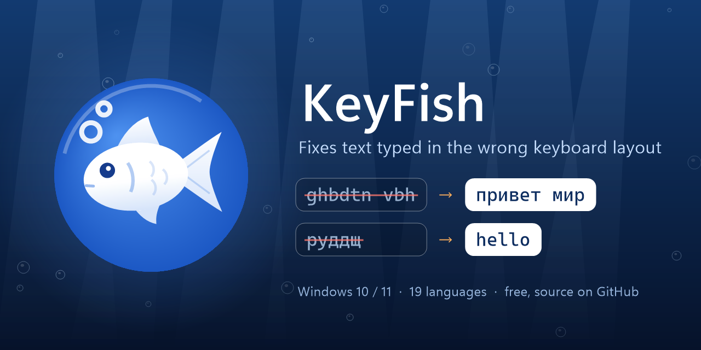

<p align="center"></p>

# KeyFish

[Русская версия](README.ru.md)

A tiny Windows tray app that fixes text typed in the wrong keyboard layout — for everyone who types in two alphabets.

> 🔒 **Your typing stays on your computer.** KeyFish sends nothing anywhere and keeps no log of what you type: it only looks at the word you are typing right now. Its single network request is asking GitHub whether a new version is out — with no data about you. On disk there is only what you see in its Settings. [Details](#privacy)

**Languages:** English, German, Polish, French, Spanish, Italian, Portuguese, Czech, Turkish, Serbian Latin ⇄ Russian, Ukrainian, Belarusian, Bulgarian, Macedonian, Serbian Cyrillic, Greek, Hebrew, Georgian. KeyFish uses the layouts installed in Windows; with several layouts it picks the language from the word and the words before it.

- **Auto-correction as you type:** `ghbdtn vbh` → «привет мир», `руддщ` → "hello", `f vj;yj` → «а можно»
- **Case fixing:** "hELLO" (accidental CapsLock) → "Hello", "HEllo" → "Hello"
- **Text replacements:** `thx` + space → "thank you" — your own list in Settings
- **Pause** or **Ctrl+Shift+Space** — switch the layout of selected text; Pause or Ctrl+Z right after an auto-fix undoes it
- **Shift+F3** — cycle the case of selected text, like in Word
- **Shift+Pause** — transliteration: «Привет» ⇄ "Privet"
- Typo fixing via Windows spell check (experimental, turn it on in Settings)
- **Layout per app:** Telegram always in Russian, VS Code in English — KeyFish switches when you go to the app
- The tray fish shows the current layout: blue — Latin, orange — another alphabet, or a color of your own per layout; or the tray can show the layout's letters (EN, RU…) instead
- Optional: **double Shift** or **Caps Lock** fixes the last word, like Pause; the layout shows next to the text cursor for a moment when it changes
- The fish menu: **pause for an hour**, and **recent corrections** — click one and KeyFish won't correct it that way again
- **Import** replacements and word lists from other programs: plain text, CSV/TSV, AutoHotkey hotstrings, Espanso; all settings export to one file, and a copy is kept before every save
- **Alt+Pause** — switch the layout of the whole line before the cursor

If you erase a correction with Backspace, KeyFish remembers the word and never touches it again; if you fix a word yourself — with Pause, or by erasing it and typing it again in the other layout — it learns to fix it next time. Links, paths and code are left alone. It stays quiet in games and full-screen apps. All hotkeys can be changed in Settings (double-click the fish). KeyFish updates itself in one click. The interface is in English, Russian, Ukrainian, Belarusian, German, Polish, Serbian, French and Spanish; the light or dark theme follows Windows.

KeyFish is free. If it saves you time, you can [buy me a coffee on Ko-fi](https://ko-fi.com/pravken) ☕

## Languages: how it decides

KeyFish fixes a word only when it is typed in a layout of *another alphabet*: say, Latin ⇄ Cyrillic or Latin ⇄ Greek. It doesn't switch between, say, English and German — both are Latin, and the same keys type nearly the same letters there.

For every word KeyFish compares what you typed with what the same keys give in your other installed layouts, using word lists and letter statistics of each language. Words it isn't sure about are left alone.

Serbian is written in both alphabets, so KeyFish treats a correct Serbian Latin word as your choice and never converts it to Cyrillic. Serbian Cyrillic, Macedonian and Greek are checked more strictly, by dictionary only: their layouts are phonetic, so an English word typed in them (hello → хелло, ηελλο) can look plausible.

## Install

Download `KeyFish.exe` from [Releases](../../releases/latest) and run it — no installation needed. Turn on autostart in Settings.

Windows may show "Windows protected your PC" on first run because the app isn't signed. Click "More info" → "Run anyway".

**If an antivirus flags KeyFish.** To fix your typing, KeyFish has to do what a keylogger does too: watch the keyboard in every app, type for you, use the clipboard and start with Windows. An antivirus that judges by behavior alone (Microsoft Defender may call it something like `Trojan:Win32/Bearfoos.A!ml`; the `!ml` means a machine-learning guess, not a known virus) can take it for one. KeyFish has no hidden behavior: the source code is here, every release is built from it by GitHub Actions, and its only network request is the update check (see [Privacy](#privacy)). To be sure you have the genuine file:

- compare its SHA-256 with `KeyFish.exe.sha256` in the release (`Get-FileHash KeyFish.exe` in PowerShell), or run `gh attestation verify KeyFish.exe --repo pravken/KeyFish`;
- if it matches, you can restore the file from quarantine (Windows Security → Protection history) and report the false positive to Microsoft at https://www.microsoft.com/wdsi/filesubmission — that helps every user.

If you'd rather not trust a downloaded exe at all, build it yourself from the source (see [Build](#build)).

## Privacy

KeyFish has to see your keystrokes to fix them, so here is exactly what it does with them:

- **Nothing is logged.** Only the word you're typing and the last few words are kept in memory, and they're dropped when you click, move the cursor or switch windows.
- **Nothing about your typing leaves your computer.** The only network request is the update check: KeyFish asks GitHub for the latest release of this repository. Spell checking uses the one built into Windows.
- **Password fields are off-limits.** In a password field — in browsers and in apps that tell Windows a field is a password field, which most do — KeyFish doesn't correct or remember anything, and its hotkeys don't work there either. Until the check has answered, nothing is corrected at all. The check runs in a small separate process, so Task Manager shows two `KeyFish.exe`: the second one (`--password-guard`) only asks Windows UI Automation whether the focused field is a password field, and it closes together with KeyFish. Some apps with their own interface (games and launchers, some Java or Qt apps) don't report password fields; add such an app in Settings → Apps with correction turned off.
- **Terminals, SSH clients, virtual machines and remote desktops are excluded by default.** A password prompt in a terminal isn't a password field Windows can recognize, and a remote computer types with its own layout. You can change the list in Settings → Apps.
- **What's stored on disk** is only what you can see and edit in Settings: your replacements, excluded apps, layouts per app and the two word lists. KeyFish adds a word to "Never correct" when you undo or erase its correction, and to "Always correct" when you fix a word yourself — single words, never sentences or anything typed around them. Before each save in Settings a copy of the previous settings goes to the `backups` folder (the last 10). All of this lives next to `KeyFish.exe` (or in `%APPDATA%\KeyFish` if that folder is read-only); settings and the mistake counter are in the registry under `HKCU\Software\KeyFish`. The diagnostic log is written only if you create `debug-log.txt` yourself, and it never contains the words.
- **The clipboard is put back.** Hotkeys on selected text go through the clipboard; KeyFish restores what was there and keeps its own text out of clipboard history (Win+V) and cloud sync. The copy of the selection itself is made by the app you're in, so Windows may still keep that one in the history.
- **Updates are verified.** One-click update downloads only from this repository's releases and checks the SHA-256 checksum published by the release build before replacing the app, so a damaged or swapped download is refused. Releases are built by GitHub Actions straight from the source code in this repository, and each one comes with a signed build attestation: `gh attestation verify KeyFish.exe --repo pravken/KeyFish` shows which commit and workflow built your file. The checksum and the attestation can't protect against someone taking over the repository itself; the open source code and the build log are there so anyone can check.

## If KeyFish crashes

Please open an issue and say what you were doing (which app or site, which key you pressed). If it happens again, double-click `tools/crash-dumps-on.reg` (needs administrator rights): Windows will then save a small crash dump to `%LOCALAPPDATA%\CrashDumps` the next time, which shows exactly where it failed. The dump can contain the last few words you typed, so send it privately rather than attaching it to a public issue. `tools/crash-dumps-off.reg` turns this off.

## If KeyFish doesn't correct somewhere

Create an empty file `debug-log.txt` next to `KeyFish.exe` (or in `%APPDATA%\KeyFish`, if the settings files are there). Within a couple of seconds KeyFish starts writing a line for every word you finish: the app, what it decided and why (for example "excluded app" or "looks right as typed") and the word's length. The words themselves are never written. Delete the file to turn this off.

## Build

Windows only: the C# compiler ships with .NET Framework 4.

```
build.bat
```

The icons are drawn by `tools\make-icon.ps1`. The version lives in `Version.cs`, the history in `CHANGELOG.md` (English) and `CHANGELOG.ru.md` (Russian).

## Credits

The frequency dictionaries in `data/` are built from [FrequencyWords](https://github.com/hermitdave/FrequencyWords) by Hermit Dave; the Belarusian word list comes from the [Belarusian AOSP dictionary](https://codeberg.org/Anibyl/Belarusian-AOSP-dictionary) by Anibyl. Both are licensed under [CC BY-SA 4.0](https://creativecommons.org/licenses/by-sa/4.0/), and the files in `data/` are distributed under the same terms. `tools/build-dictionaries.ps1` rebuilds them from the sources.
