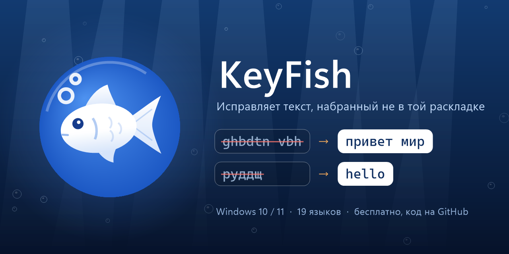

<p align="center"></p>

# KeyFish

[English version](README.md)

Маленькая программа для Windows, которая живёт в трее и исправляет текст, набранный не в той раскладке.

> 🔒 **Ваш набор не покидает компьютер.** KeyFish ничего никуда не отправляет и не ведёт журнал набора: он смотрит только на слово, которое вы печатаете прямо сейчас. В сеть он выходит, только чтобы спросить у GitHub, вышла ли новая версия, и скачать расширенный словарь, если вы нажмёте кнопку, — без каких-либо данных о вас. На диске только то, что видно в его настройках. [Подробнее](#конфиденциальность)

**Языки:** английский, немецкий, польский, французский, испанский, итальянский, португальский, чешский, турецкий, сербская латиница ⇄ русский, украинский, белорусский, болгарский, македонский, сербская кириллица, греческий, иврит, грузинский. KeyFish берёт раскладки, установленные в Windows; если раскладок несколько, язык определяется по слову и предыдущим словам.

- **Автоисправление при наборе:** `ghbdtn vbh` → «привет мир», `руддщ` → «hello», `f vj;yj` → «а можно»
- **Исправление регистра:** «пРИВЕТ» (случайный CapsLock) → «Привет», «ПРивет» → «Привет»
- **Автозамены:** `спс` + пробел → «спасибо» — свой список в настройках
- **Pause** или **Ctrl+Shift+Space** — перевести выделенный текст в другую раскладку; Pause или Ctrl+Z сразу после автоисправления — отменить его
- **Shift+F3** — сменить регистр выделенного текста по кругу, как в Word
- **Shift+Pause** — транслитерация: «Привет» ⇄ «Privet»
- Исправление опечаток через проверку орфографии Windows (эксперимент, включается в настройках)
- **Раскладка для программы:** Telegram всегда на русском, VS Code на английском — KeyFish переключит сам, когда вы перейдёте в программу
- Рыбка в трее показывает раскладку: синяя — латиница, оранжевая — другой алфавит, или свой цвет для каждой раскладки; а можно вместо рыбки буквы раскладки (EN, RU…)
- По желанию: **двойной Shift** или **Caps Lock** исправляет последнее слово, как Pause; при смене раскладки она на секунду появляется рядом с текстовым курсором
- Меню рыбки: **пауза на час** и **последние исправления** — нажмите на любое, и KeyFish больше так не исправит
- **Импорт** автозамен и списков слов из других программ: обычный текст, CSV/TSV, автозамены AutoHotkey, Espanso; все настройки выгружаются одним файлом, а перед каждым сохранением остаётся копия
- **Alt+Pause** — раскладка всей строки до курсора

Если стереть исправленное слово Backspace'ом, программа запомнит его и больше не будет трогать; если исправить слово самому — через Pause или стерев и набрав заново в другой раскладке, — научится исправлять его сама. Ссылки, пути и код программа не трогает. В играх и полноэкранных программах рыбка молчит. Все сочетания клавиш меняются в настройках (двойной щелчок по рыбке). Обновляется в один клик. Интерфейс на русском, английском, украинском, белорусском, немецком, польском, сербском, французском и испанском; светлая или тёмная тема — как в Windows или на ваш выбор в настройках.

KeyFish бесплатный. Если он экономит вам время, можно [угостить автора кофе на Ko-fi](https://ko-fi.com/pravken) ☕

## Языки: как KeyFish решает

KeyFish исправляет слово, только если оно набрано в раскладке *другого алфавита*: например, латиница ⇄ кириллица или латиница ⇄ греческий. Между, скажем, английской и немецкой он не переключает — обе латинские, и одни и те же клавиши дают там почти одинаковые буквы.

Для каждого слова KeyFish сравнивает набранное с тем, что дают те же клавиши в других установленных раскладках, по словарям и буквенной статистике каждого языка. Если он не уверен, слово остаётся как есть.

Сербский пишут обоими алфавитами, поэтому правильное слово на сербской латинице KeyFish считает вашим выбором и никогда не переводит в кириллицу. Сербская кириллица, македонский и греческий проверяются строже, только по словарю: их раскладки фонетические, и английское слово, набранное в них (hello → хелло, ηελλο), может выглядеть правдоподобно.

## Установка

Скачайте `KeyFish.exe` из [релизов](../../releases/latest) и запустите. Установка не нужна. Автозапуск включается в настройках.

При первом запуске Windows может показать «Windows защитила ваш компьютер» — программа не подписана. Нажмите «Подробнее» → «Выполнить в любом случае».

**Если антивирус ругается на KeyFish.** Чтобы исправлять набор, KeyFish делает то же, что и клавиатурный шпион: следит за клавиатурой во всех программах, печатает за вас, пользуется буфером обмена и запускается вместе с Windows. Антивирус, который судит только по поведению, может принять его за шпиона (Защитник Windows называет это, например, `Trojan:Win32/Bearfoos.A!ml`; `!ml` означает догадку машинного обучения, а не известный вирус). Скрытого поведения у KeyFish нет: исходный код открыт, каждый релиз собирает из него GitHub Actions, а единственный запрос в сеть — проверка обновлений (см. [Конфиденциальность](#конфиденциальность)). Чтобы убедиться, что у вас настоящий файл:

- сверьте его SHA-256 с файлом `KeyFish.exe.sha256` из релиза (`Get-FileHash KeyFish.exe` в PowerShell) или выполните `gh attestation verify KeyFish.exe --repo pravken/KeyFish`;
- если совпадает, файл можно вернуть из карантина («Безопасность Windows» → «Журнал защиты») и сообщить Microsoft о ложном срабатывании на https://www.microsoft.com/wdsi/filesubmission — это поможет всем пользователям.

Если не хотите доверять скачанному exe вообще, соберите его сами из исходников (см. [Сборка](#сборка)).

## Конфиденциальность

Чтобы исправлять набор, KeyFish должен видеть нажатия клавиш. Вот что именно он с ними делает:

- **Ничего не записывается.** В памяти хранится только набираемое слово и несколько последних, и они стираются при клике мышью, движении курсора или смене окна.
- **Ничего о вашем наборе не уходит с компьютера.** В сеть KeyFish выходит только для проверки обновлений (спрашивает у GitHub последний релиз этого репозитория) и — если вы нажмёте «Скачать» в настройках — за расширенным словарём из релизов этого репозитория; файлы сверяются с опубликованными контрольными суммами SHA-256. Проверка орфографии — встроенная в Windows.
- **Поля паролей неприкосновенны.** В поле пароля — в браузерах и в программах, которые сообщают Windows, что это поле пароля (так делает большинство), — KeyFish ничего не исправляет и не запоминает, и его горячие клавиши там тоже не работают. Пока проверка не ответила, не исправляется вообще ничего. Эта проверка работает в отдельном маленьком процессе, поэтому в Диспетчере задач два `KeyFish.exe`: второй (`--password-guard`) только спрашивает у Windows (UI Automation), не поле ли пароля в фокусе, и закрывается вместе с KeyFish. Некоторые программы со своим интерфейсом (игры и лаунчеры, часть программ на Java или Qt) не сообщают о полях паролей; добавьте такую программу в Настройках → Программы с выключенным исправлением.
- **Терминалы, SSH-клиенты, виртуальные машины и удалённые рабочие столы исключены по умолчанию.** Запрос пароля в терминале Windows не распознаёт как поле пароля, а удалённый компьютер печатает в своей раскладке. Список можно изменить в Настройках → Программы.
- **На диске хранится** только то, что видно и правится в настройках: автозамены, исключённые программы, раскладки для программ и два списка слов. В «Не исправлять» KeyFish добавляет слово, когда вы отменяете или стираете его исправление, а во «Всегда исправлять» — когда вы исправляете слово сами; это отдельные слова, никогда не предложения и не то, что вы набирали рядом. Перед каждым сохранением настроек копия прежних уходит в папку `backups` (последние 10). Всё это лежит рядом с `KeyFish.exe`, если это ваша папка — внутри вашего профиля, уже с файлами KeyFish или с пустым файлом `portable.txt`, — а иначе (общая папка или только для чтения) в `%APPDATA%\KeyFish`; настройки и счётчик ошибок — в реестре, в `HKCU\Software\KeyFish`. Журнал диагностики пишется, только если вы сами создадите `debug-log.txt`, и в нём никогда нет самих слов. В `crash.log` — только ошибки и записи о падениях, см. [Если KeyFish падает](#если-keyfish-падает).
- **Буфер обмена возвращается на место.** Горячие клавиши для выделенного текста работают через буфер обмена: KeyFish восстанавливает его содержимое, а свой текст не пускает в журнал буфера (Win+V) и облачную синхронизацию. Копию выделения делает сама программа, в которой вы работаете, поэтому её Windows всё же может сохранить в журнале.
- **Обновления проверяются.** Обновление в один клик скачивает файлы только из релизов этого репозитория и сверяет контрольную сумму SHA-256, которую публикует сборка релиза, прежде чем заменить программу, — повреждённый или подменённый файл не установится. Релизы собирает GitHub Actions прямо из исходного кода этого репозитория, и у каждого есть подписанное подтверждение сборки: `gh attestation verify KeyFish.exe --repo pravken/KeyFish` покажет, какой коммит и какой сценарий собрали ваш файл. От захвата самого репозитория ни контрольная сумма, ни подтверждение не защищают — для этого открыт исходный код и журнал сборки, их может проверить любой.
- **Держите KeyFish в отдельной папке** (или рядом с другими программами), а не среди случайных загрузок: KeyFish берёт библиотеки Windows только из системной папки, но среда .NET запускается чуть раньше и может подхватить некоторые из папки программы.

## Если KeyFish падает

KeyFish записывает, что пошло не так, в `crash.log` рядом с `KeyFish.exe` (или в `%APPDATA%\KeyFish`): свои ошибки с местом в коде, а если его закрыло аварией — запись Windows об этом падении, которую он копирует при следующем запуске. Набранного текста там нет, папка пользователя Windows записывается как `%USERPROFILE%`, и сам KeyFish ничего никуда не отправляет: после падения он предложит открыть готовое обращение на GitHub с отчётом — вы его прочитаете и отправите сами — или скопировать отчёт. Можно и самому создать обсуждение (issue), приложить `crash.log` и опишите, что делали: в какой программе или на каком сайте, какую клавишу нажали. Если этого не хватит, дважды щёлкните `tools/crash-dumps-on.reg` (нужны права администратора): в следующий раз Windows сохранит маленький «слепок» падения в `%LOCALAPPDATA%\CrashDumps`, по которому видно точное место ошибки. В слепке могут оказаться последние набранные слова, поэтому присылайте его лично, а не прикладывайте к публичному обсуждению. `tools/crash-dumps-off.reg` выключает это.

## Если KeyFish где-то не исправляет

В программах-исключениях (Настройки → Программы) выключено не только автоисправление, но и горячие клавиши: в редакторах кода есть встроенные терминалы, где Ctrl+C от горячей клавиши прервал бы запущенную команду. Если горячие клавиши в редакторе нужнее, уберите его из списка.

В программы, запущенные от имени администратора (и в Диспетчер задач — он запускается так всегда), Windows не пускает программы с меньшими правами: KeyFish не видит, что вы там набираете, и не может там печатать. В такой программе рыбка серая, а горячая клавиша объясняет, почему ничего не произошло. Чтобы KeyFish работал и в них, запустите его тоже от имени администратора.

Создайте пустой файл `debug-log.txt` рядом с `KeyFish.exe` (или в `%APPDATA%\KeyFish`, если файлы настроек лежат там). Через пару секунд KeyFish начнёт записывать строку на каждое законченное слово: программу, что он решил и почему (например, «программа в исключениях» или «слово набрано верно») и длину слова. Сами слова не записываются никогда. Удалите файл, чтобы выключить запись.

## Сборка

Нужен только Windows: компилятор C# входит в .NET Framework 4.

```
build.bat
```

Значок рисует `tools\make-icon.ps1`. Версия — в `Version.cs`, история изменений — в `CHANGELOG.ru.md` (по-русски) и `CHANGELOG.md` (по-английски).

## Лицензия

Код — под [лицензией MIT](LICENSE). Списки слов в `data/` и расширенные словари — под CC BY-SA 4.0 (см. ниже).

## Благодарности

Частотные словари в `data/` построены на основе [FrequencyWords](https://github.com/hermitdave/FrequencyWords) (Hermit Dave), белорусский список слов — из [Belarusian AOSP dictionary](https://codeberg.org/Anibyl/Belarusian-AOSP-dictionary) (Anibyl). Оба под лицензией [CC BY-SA 4.0](https://creativecommons.org/licenses/by-sa/4.0/), файлы в `data/` распространяются на тех же условиях. `tools/build-dictionaries.ps1` пересобирает их из источников. Расширенные словари (Настройки → Расширенный словарь) — это слова из полных списков FrequencyWords, встретившиеся не меньше 20 раз, которых нет в `data/`; их собирает `tools/build-dictionaries.ps1 -Extended`, а `.github/workflows/dictionaries.yml` публикует как релиз `dictionaries-N` на тех же условиях лицензии.
