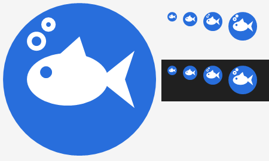

# KeyFish

[English version](README.md)

Маленькая программа для Windows, которая живёт в трее и исправляет текст, набранный не в той раскладке.

- **Автоисправление при наборе:** `ghbdtn vbh` → «привет мир», `руддщ` → «hello», `f vj;yj` → «а можно»
- **Исправление регистра:** «пРИВЕТ» (случайный CapsLock) → «Привет», «ПРивет» → «Привет»
- **Автозамены:** `спс` + пробел → «спасибо» — свой список в настройках
- **Pause** или **Ctrl+Shift+Space** — перевести выделенный текст в другую раскладку; Pause или Ctrl+Z сразу после автоисправления — отменить его
- **Shift+F3** — сменить регистр выделенного текста по кругу, как в Word
- **Shift+Pause** — транслитерация: «Привет» ⇄ «Privet»
- Исправление опечаток через проверку орфографии Windows (эксперимент, включается в настройках)
- Рыбка в трее показывает раскладку: синяя — английская, оранжевая — русская

Если стереть исправленное слово Backspace'ом, программа запомнит его и больше не будет трогать; если исправить слово самому через Pause — научится исправлять его сама. В играх и полноэкранных программах рыбка молчит. Все сочетания клавиш меняются в настройках (двойной щелчок по рыбке). Обновляется в один клик. Интерфейс на русском или английском.

## Установка

Скачайте `KeyFish.exe` из [релизов](../../releases/latest) и запустите. Установка не нужна. Автозапуск включается в настройках.

При первом запуске Windows может показать «Windows защитила ваш компьютер» — программа не подписана. Нажмите «Подробнее» → «Выполнить в любом случае».

## Конфиденциальность

Чтобы исправлять набор, KeyFish должен видеть нажатия клавиш. Вот что именно он с ними делает:

- **Ничего не записывается.** В памяти хранится только набираемое слово и несколько последних, и они стираются при клике мышью, движении курсора или смене окна.
- **Ничего о вашем наборе не уходит с компьютера.** Единственный запрос в сеть — проверка обновлений: KeyFish спрашивает у GitHub последний релиз этого репозитория. Проверка орфографии — встроенная в Windows.
- **Поля паролей неприкосновенны.** В поле пароля любой программы, включая браузеры, KeyFish ничего не исправляет и не запоминает.
- **На диске хранится** только то, что вы сами попросили: автозамены, списки слов «не исправлять» и «всегда исправлять» (рядом с `KeyFish.exe`), а также настройки и счётчик ошибок в реестре, в `HKCU\Software\KeyFish`.
- **Обновления проверяются.** Обновление в один клик скачивает файлы только из релизов этого репозитория и сверяет контрольную сумму SHA-256, которую публикует сборка релиза, прежде чем заменить программу. Релизы собирает GitHub Actions прямо из исходного кода этого репозитория.

## Сборка

Нужен только Windows: компилятор C# входит в .NET Framework 4.

```
build.bat
```

Значок рисует `tools\make-icon.ps1`. Версия — в `Version.cs`, история изменений — в `CHANGELOG.ru.md` (по-русски) и `CHANGELOG.md` (по-английски).

## Благодарности

Частотные словари в `data/` построены на основе [FrequencyWords](https://github.com/hermitdave/FrequencyWords) (Hermit Dave), лицензия [CC BY-SA 4.0](https://creativecommons.org/licenses/by-sa/4.0/). Файлы в `data/` распространяются на тех же условиях.
